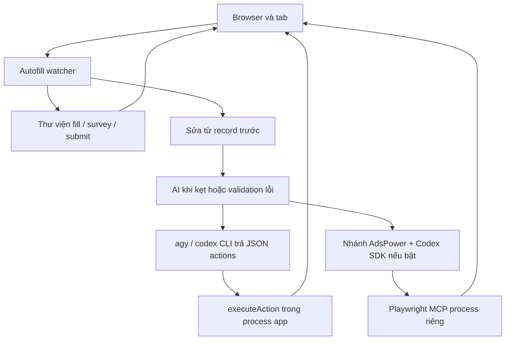
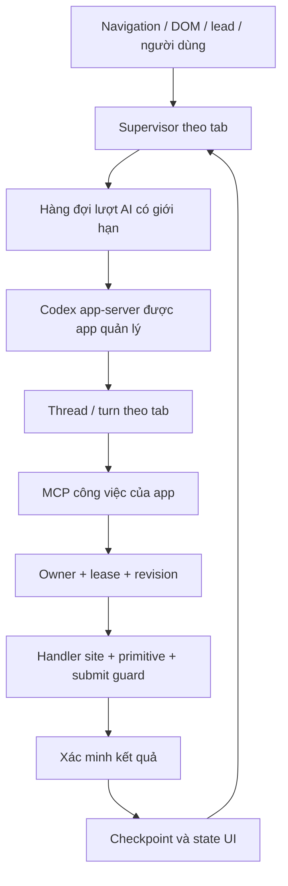

# Báo cáo nghiên cứu AI + MCP điều khiển autofill liên tục

Ngày: 2026-11-15. Repository tại thời điểm đối chiếu: `4752d25` cộng thay đổi tài liệu chưa commit. Tiếp nối nghiên cứu Kimi `session_d7afa0bf-5373-46d3-a182-bb7ae0886746` và `CONTINUOUS_AI_AGENT_PLAN.md`.

**Phạm vi lượt này: tìm tài liệu, đọc source và kiểm tra artifact cục bộ. Không sửa implementation, không gọi model, không khởi chạy browser/worker, không mua dịch vụ và không build app.**

## 1. Kết luận để quyết định

Có thể phát triển tính năng này trên nền app hiện tại. App đã có nhiều phần giá trị: record riêng theo phiên/tab, form scope/iframe, primitive chuột/nhập/chọn, xác minh field, submit có guard, theo dõi lead, phục hồi trang, hàng đợi AI và log có giới hạn. Không nên viết lại những phần này trong agent.

Tuy nhiên, app **chưa có continuous controller hoàn chỉnh**. Lựa chọn Continuous trên UI không tạo worker/thread bền vững theo tab. Các cờ “AI đang chạy” hiện tại hỗ trợ các lượt sửa form ngắn, chưa phải cơ chế chuyển quyền và phục hồi đủ cho 24/7.

Phần phải bổ sung trước khi cho AI chạy từ đầu đến cuối là: quyền điều khiển duy nhất theo tab, cổng MCP thao tác qua nghiệp vụ app, supervisor theo sự kiện, vòng đời worker/thread/turn, cancellation, checkpoint, chính sách quota và quan sát trạng thái. Khó nhất là giữ đúng hành vi giữa nhiều luồng cùng tồn tại, không phải gửi prompt tới model.

Hướng ưu tiên nghiên cứu tiếp: **app-server sống lâu + thread theo tab + MCP nghiệp vụ của app**. Chỉ chọn chính thức sau spike chứng minh tương thích, không coi việc có CLI app-server là bằng chứng đã chạy ổn định 24/7.

## 2. Cách kiểm tra và độ tin cậy

- Đọc yêu cầu cuối và phần nghiên cứu chưa ghi thành công trong wire log của phiên Kimi; không thực thi lại tool command từ session cũ.
- Dùng knowledge graph để tìm và truy caller, sau đó đọc file source hiện tại. Graph có dữ liệu cũ, nên không dùng graph thay bằng chứng source.
- Đọc code hai nhánh AI, watcher, form scope, guard lead/submit, MCP, route/UI, logging, lifecycle và các test liên quan.
- Kiểm tra phiên bản cài: Codex SDK **0.163.0**, CLI hệ thống **0.169.0**, Playwright MCP **0.0.83**, Playwright **1.64.0**, GoLogin **3.0.8**. Khoảng version trong package.json không phải version thực tế đang cài.
- App cài tại `/Applications/AutoLeadPC Mac 2 AdsPower.app` là **build 64**. So SHA-256 1.644 file trong `src/` và `ui/`: không khác source. Các file gốc `app.mjs`, `mcp-server.mjs`, `playwright-mcp-human.cjs`, package.json/package-lock.json cũng khớp. Chưa so từng file node_modules trong bundle.
- Đã có schema local từ CLI 0.169.0: 329 JSON schema cho giao thức app-server, xác nhận các nhóm thread/turn. Đây là kiểm tra giao diện giao thức, không phải kiểm thử model hoặc MCP live.
- Không đọc token, auth.json, proxy credentials hoặc record thật. Không lấy log form/lead thật để đưa vào báo cáo.

Mức kết luận: hiện trạng source có độ tin cậy cao trong các đường đã đọc; hiệu năng, mức phí và độ bền 24/7 vẫn chưa có benchmark/soak trong nghiên cứu này.

## 3. Tài liệu chính thức đã đối chiếu

| Mã | Nguồn | Điều đã xác minh và tác động |
|---|---|---|
| S1 | [OpenAI Codex SDK](https://developers.openai.com/codex/sdk/) | Có mô hình thread/run; hành vi spawn mỗi turn còn được xác minh trực tiếp trong SDK đang cài. |
| S2 | [OpenAI App Server](https://developers.openai.com/codex/app-server/) | Có initialize, thread start/resume, turn start/interrupt, compaction và sự kiện. Dynamic tools là experimental. Phải pin schema với binary, không chép toàn bộ API từ tài liệu mới vào CLI cũ. |
| S3 | [Codex configuration reference](https://developers.openai.com/codex/config-reference/) | Có allowlist/denylist tool MCP. Cấu hình phê duyệt không thay việc app kiểm tra quyền thao tác. |
| S4 | [Codex authentication](https://developers.openai.com/codex/auth/) | Có xác thực ChatGPT và API key; chi phí/quyền khác nhau. Không mặc định mua GoLogin đã gồm quota AI. |
| S5 | [Playwright MCP — Microsoft](https://github.com/microsoft/playwright-mcp) | Hỗ trợ CDP, snapshot và nhiều tool browser; dự án nói rõ MCP này không phải security boundary. README main không đại diện đầy đủ bản 0.0.83 đang cài. |
| S6 | [Playwright connectOverCDP](https://playwright.dev/docs/api/class-browsertype#browser-type-connect-over-cdp) | Chỉ áp dụng browser Chromium, độ tương thích thấp hơn kết nối native Playwright. Cần thử chức năng dùng trên từng engine. |
| S7 | [Playwright actionability](https://playwright.dev/docs/actionability) | Có kiểm tra điều kiện tương tác; click thành công vẫn không chứng minh form đã được server chấp nhận. |
| S8 | [MCP versioning hiện hành](https://modelcontextprotocol.io/specification/versioning) | Current là 2026-07-28; version/capability được khai báo theo request, có hướng tương thích với các bản handshake cũ. |
| S9 | [MCP lifecycle 2025-11-25](https://modelcontextprotocol.io/specification/2025-11-25/basic/lifecycle) | Bản handshake cũ dùng initialize/initialized; chỉ dùng nếu client/server cùng hỗ trợ. Không gọi đây là bản mới nhất. |
| S10 | [MCP transports 2026-07-28](https://modelcontextprotocol.io/specification/2026-07-28/basic/transports) | stdio và Streamable HTTP có cách framing/cancellation riêng; không dùng kết nối SSE màn hình của app như thể là MCP. |
| S11 | [MCP cancellation 2026-07-28](https://modelcontextprotocol.io/specification/2026-07-28/basic/patterns/cancellation) | stdio hủy bằng notification, HTTP bằng đóng response stream. Cancellation có race và không đảo ngược tác động đã xảy ra. |
| S12 | [MCP tools 2025-11-25](https://modelcontextprotocol.io/specification/2025-11-25/server/tools) | Với baseline này: phân biệt lỗi protocol và tool result isError, validate input và quyền. Cần ánh xạ lại khi chọn baseline mới. |
| S13 | [GoLogin Cloud getting started](https://gologin.com/docs/api-reference/cloud-browser/getting-started) | Cloud dùng endpoint CDP và API profile; đây là nơi chạy browser, không tự chạy supervisor autofill của app. |
| S14 | [GoLogin session management](https://gologin.com/docs/api-reference/cloud-browser/manage-a-browser-session) | Cần dùng lại kết nối trong workflow, quản lý stop và concurrency; reconnect không được hứa giữ nguyên DOM/tab. |

App-server JSON-RPC và MCP JSON-RPC là **hai giao thức khác nhau**. MCP 2026 thay đổi không có nghĩa các method initialize/thread/turn của app-server phải đổi theo MCP. Cần test riêng từng kết nối.

## 4. App đang có những gì

### 4.1. Luồng thực tế

Đây là sơ đồ hiện trạng; không phải sơ đồ continuous đã được triển khai.

### 4.2. Kiểm kê code

| Nhóm | File hiện có | Đã có | Thiếu cho continuous |
|---|---|---|---|
| Cấu hình | `src/ai-assist/state/global-ai-config.mjs`, `set-global-ai-config.mjs` | enabled/mode/binary/rounds/timeout; mặc định auto_on_stuck, agy, useCodexMcp=false | Dispatch riêng continuous, cấu hình worker/budget có hợp đồng rõ |
| Lưu cấu hình | `src/config/ai/`, route `/ai/config` | Lưu JSON và cập nhật singleton | Validation mode/giới hạn và chính sách áp dụng vào phiên đang chạy |
| AI CLI | `call-agt.mjs`, `execute-agt-process.mjs` | Spawn từng request, timeout, fallback agy↔codex, parse JSONL Codex | AbortSignal xuyên suốt, quản lý process tree, phân loại quota/auth, circuit breaker |
| AI lặp ngắn | `run-ai-assist.mjs` | Max rounds, kiểm work/signature, actions rồi đợi tiến triển | Thread bền, supervisor, quyền theo generation và cancel theo tab |
| Repair | `inspect-and-fix-form-with-ai.mjs` | Chẩn đoán blocker, record, retry limit, capacity và verify lại | Không dùng nguyên khóa repair làm owner cả workflow |
| SDK/MCP | `src/codex-form-agent/run-codex-form-agent.mjs` | Tạo Codex/thread, stream events, timeout/abort sau lead | Giữ worker, resume, target tab rõ ràng, verify submit, stop lifecycle chung |
| Wrapper MCP | `playwright-mcp-human.cjs`, `enforce-mcp-repair-policy.mjs` | Gõ chậm; repair chỉ cho đọc/type/select đúng tập giá trị, cấm submit/click | Scope/record theo field, lease và site rules của app; tập giá trị chưa ràng buộc field tương ứng |
| MCP cấp app | `mcp-server.mjs` | stdio, tools status/start/stop/queue/log/Telegram… | Tool nhỏ theo tab/form, request validation, deadline/cancellation và kết quả có cấu trúc |
| Lượt AI | `wait-for-ai-capacity.mjs`, `state/module-state.mjs` | 4 lượt, lead priority, FIFO cùng nhóm, bỏ stale state, timeout 15s | Ticket continuous chờ có thể hủy, không giữ lượt lúc idle, không tự tạo counter song song |
| Nhìn trạng thái | `visible-state/read-visible-page-state.mjs` | Scoped controls/questions/errors, signature, timeout frame | Định danh tab/frame/control bền trong một revision, nội dung delta và giới hạn output |
| Retry state | `retry/ai-state-gate.mjs` | WeakMap chặn gọi lại cùng thất bại, mở lại khi state thay đổi | Persist checkpoint và phân biệt stale lease với thất bại thực sự |
| Giải mục tiêu | `resolve-action-target.mjs` | Chuẩn hóa selector, active frame/scope, readiness | Handle gắn revision/owner; reject action cũ sau navigation/record đổi |
| Thực thi AI | `execute-action.mjs` | Dùng human input, record-only, chặn submit/semantic ngoài quyền, verify field | Broker cho continuous và kết quả thống nhất xuyên các handler |
| Khởi tạo autofill | `attach-autofill.mjs` | Offer mode, record clone theo phiên, assigned email, gắn watcher | Chọn owner ngay từ đầu, không khởi động thao tác thư viện song song agent |
| Watcher | `attach-autofill-page-watcher.mjs` | Khóa scan trước await, backoff, local repair trước AI, event navigation | Tách observer khỏi action; event coalescing và quyền cho repair/reload/dialog/popup |
| Điền form | `fill-page-forms.mjs` | Frame/scope, field, survey, validation, submit và lead guard | Không public cả hàm nhiều tác động làm tool mơ hồ; adapter công việc cần rõ phạm vi |
| Scope | `src/autofill/form-scope/` | Phục hồi scope, revision, label của input ẩn, không quét global khi scope lỗi | Liên kết scope revision vào mọi tool AI |
| Chuột/select | `human-*`, `select/`, `interaction/` | Con trỏ, pacing, native/custom select | Cancel theo lease trước mỗi bước tiếp; remote CDP benchmark |
| Site rules | `adsmith/`, `yes-no/`, `late-progress/` | Luật site, Save trước Continue, fallback, màn trống reload có giới hạn | Agent gọi lại handler; không tự tái hiện luật bằng prompt |
| Lead | `should-pause-for-lead.mjs`, `should-stop-after-lead.mjs`, `src/leads/` | Chờ opt-in, confirmed protection, recovery, completion có điều kiện | Observer độc lập tiếp tục trong lúc agent giữ owner; lead đến phải revoke/cancel kịp |
| Browser lifecycle | GoLogin `attach-session-lifecycle.mjs`; shared close/refill | Khóa IP/proxy, close/reconnect engine, guard manual stop | Hủy agent/ticket/lease trước thay context/slot và không hồi sinh phiên đã Stop |
| Thao tác tay | `src/http/routes/screen/post-input.mjs` | Click/key/wheel/select qua Screen View | Takeover/pause agent, không cùng gõ với người dùng |
| UI/API | desktop/mac/mini; `/ai/trigger` | Chọn mode, lưu config, gọi AI thủ công | Trạng thái/nút theo tab, error reason, stable IDs; không chỉ slot/mainPage |
| Logging | `src/logging/`, lifecycle logger, recorder | Access mode ít log, full/debug có giới hạn | Terminal AI lỗi cần giữ có chọn lọc, state UI không phụ thuộc log đầy đủ |
| Đóng gói | `build-app.sh`, Swift wrapper | Node/runtime/assets/tests và process con của app | Chọn/pin Codex binary, worker cleanup và kiểm tra app bundle thật |

## 5. Những vấn đề cần xử lý trước khi mở rộng

Đây là đánh giá source, không phải kết luận đã tái hiện mọi lỗi trên website thật. P0 là điều kiện chặn việc bật continuous rộng rãi; P1 phải xong trước pilot dài; P2 là tối ưu/triển khai sau.

### P0-1. Chưa có quyền điều khiển duy nhất xuyên mọi đường

Watcher kiểm `filling`, `_aiAssistRunning`, `_aiFormFixing`, nhưng còn nhiều tác động ở thư viện, repair, late-progress reload, lead recovery, dialog và popup. Các cờ riêng lẻ không thu hồi được tool đang chờ ở process MCP. Screen View input chưa có hợp đồng takeover agent.

Hậu quả khi thêm continuous: AI điền, thư viện scan hoặc người dùng có thể đụng cùng một tab. Cần owner/lease/generation chung và kiểm lại trước tác động sau await. Không chỉ chặn đầu `fillVisibleForms`.

### P0-2. MCP độc lập không sở hữu state nghiệp vụ của app

SDK cấp CDP endpoint browser cho Playwright MCP. Process này không có Page object, record/scope state và các WeakMap của process app. Target URL trong prompt không phải ràng buộc một tab, đặc biệt khi nhiều tab cùng URL.

Cần MCP công việc của app với target/session/record revision rõ ràng; không dùng raw browser_click/type/evaluate làm đường thực thi continuous. Nếu dùng snapshot từ MCP khác thì refs không được tự coi là handles của app.

### P0-3. Runner SDK có kết quả submit/approval không phản ánh tác động thật

`run-codex-form-agent.mjs:199` chọn `submitted` từ cờ allowSubmit; `approvalGate` được gọi sau vòng tool (`:200`), không phải ngay trước click gửi. Vì vậy tên trạng thái/approval không chứng minh đã ngăn hoặc xác minh submit.

**Giới hạn kết luận:** caller repair đã đọc đang truyền `allowSubmit:false`, `repairOnly:true`; không kết luận luồng repair hiện đang tự submit. Nhưng không được tái sử dụng nhánh allowSubmit này làm submit gateway cho continuous. Quyền phải kiểm tại action trước click, kết quả phải xác minh sau click.

### P0-4. Stop/hủy chưa là hợp đồng chung cho CLI và tool

`execute-agt-process.mjs` không nhận AbortSignal; timeout gọi child.kill nhưng không có cơ chế đợi toàn process tree. `close-active-browsers.mjs` đặt session closed và đóng browser, chưa có registry agent để cancel/join worker và tool theo tab. SDK có abort theo timeout/lead nhưng chưa chung với lệnh pause/stop continuous.

Cần revoke quyền ngay, cancel đúng request/turn, xử lý response muộn và chờ tác động in-flight kết thúc/timeout trước chuyển owner. Không hứa undo click đã gửi thành công.

### P0-5. Chưa xác định ranh giới năng lực của Codex worker

CLI hiện có cờ bypass permission/sandbox. SDK tạo thread workspace-write. Nếu chỉ hạn chế MCP mà worker vẫn có shell/evaluate hoặc công cụ khác đọc endpoint và tác động browser thì guard có thể bị đi vòng.

Continuous cần cấu hình worker giới hạn phù hợp, kiểm chứng tool catalog thực tế và không đưa credential/browser endpoint cho model khi không cần. Đây là yêu cầu trực tiếp để các guard record/lead/submit có hiệu lực, không phải chỉ thêm lời nhắc trong prompt.

### P1-1. UI continuous có nhưng runtime chưa phân nhánh

`runAiAssist` và repair xử lý disabled/heuristic, không có controller continuous riêng. Toggle dashboard còn đổi về auto_on_stuck/disabled. Cần hợp đồng enabled/mode/transport rõ ràng, tránh checkbox làm người dùng nghĩ AI đang giữ tab liên tục.

### P1-2. GoLogin có CDP nhưng caller SDK vẫn chỉ AdsPower

`inspect-and-fix-form-with-ai.mjs:198` kiểm `session.isAdsPower`. GoLogin dùng CLI fallback khi kẹt dù có browserWebSocketUrl. Không sửa bằng cách chỉ bỏ một điều kiện: MCP phải bind đúng tab, giữ Android touch/window/reconnect và guard riêng của GoLogin.

### P1-3. MCP cấp app hiện quá rộng và đơn giản cho agent theo tab

`mcp-server.mjs:247` hard-code protocol 2024-11-05; chưa negotiate nhiều revision. Tools/call không có kiểm input schema tập trung, không có cancellation registry; lỗi nghiệp vụ phần lớn trở thành text trả bình thường. Các async handler chạy đồng thời. Nó có tool stop app, mua proxy, gửi Telegram và dọn log — không nên cấp nguyên bộ cho agent form.

Giữ MCP quản trị tương thích; bổ sung surface công việc riêng thay vì nhồi mọi trách nhiệm vào file gốc. Không tự chạy các tool quản trị/nhắn tin trong nghiên cứu này.

### P1-4. Hàng đợi 15 giây là chính sách lượt repair, không phải vòng đời continuous

Không giữ bốn chỗ qua nhiều phút chờ trang/lead. Cũng không đổi timeout thành Infinity: waiter hiện có deadline/signature và polling theo lượt. Cần ticket được hủy/đánh thức lại, dùng chung capacity hiện tại, báo queued rõ ràng và không tiêu retry khi chưa acquired.

### P1-5. API thủ công chưa chọn đúng tab/record một cách bền vững

`/ai/trigger` tìm slot, dùng mainPage, fallback record đầu queue khi session thiếu record. Điều này không phù hợp action giao diện đang xem trên tab phụ. Cần định danh tab ổn định, xác nhận record của tab và reject missing record; không lấy bất kỳ record sẵn có để cứu agent.

### P1-6. Chưa có checkpoint nghiệp vụ xuyên restart

Page/WeakMap/cờ session mất khi process app khởi động lại. GoLogin thay Page objects khi nối lại; không dùng URL đơn thuần để phân biệt hai tab cùng URL. Thread resume không khôi phục submit/offer đã mở hay bảo vệ lead của app.

### P1-7. Provider fallback hiện chưa phân loại lỗi

`callAgt` có thể fallback provider cho mọi lỗi nếu không tắt. Continuous cần phân biệt quota, auth, lỗi tool, invalid state và transient network; không fallback khi Stop, không resume cùng threadId sang provider khác và không gọi dồn khi hết quota.

### P1-8. Logging hiện không đủ làm nguồn trạng thái agent

Access mode lọc gần hết log AI thường. Không thể dựa vào sự có/không có log để nói agent đang hoạt động. Phải có state API riêng và chỉ giữ log chuyển trạng thái terminal, Stop, failed recovery; không bật full recorder cho 20 browser để chữa thiếu trạng thái.

## 6. Thiết kế bổ sung được đề xuất

### 6.1. Ba lớp vòng đời

- Supervisor sống theo session/tab, không theo một request AI. Browser/người dùng vẫn do app quản lý.
- Thread giữ ngữ cảnh nhiệm vụ, turn là một lượt xử lý có hạn. Không gọi model khi chỉ đang chờ trang.
- Bắt đầu với một app-server worker rồi đo số thread/MCP process thực tế. Một process app-server không bảo đảm toàn bộ ứng dụng chỉ có một process MCP; stdio server có thể được tạo theo kết nối/thread.
- Không tạo mặc định một Codex process/browser. Chỉ thêm pool khi số đo chứng minh cần.

### 6.2. Các lựa chọn transport

| Lựa chọn | Điểm mạnh | Vướng mắc | Đề xuất |
|---|---|---|---|
| SDK hiện tại, turn dài | Ít thay đổi nhất | Resume spawn lại; vẫn cần broker/lease | Phương án pilot nhỏ nếu chấp nhận process thay đổi |
| Codex app-server + MCP app | Tách worker/thread/turn, có interrupt/events | Binary/protocol compatibility, quản lý process và tool surface | Ưu tiên spike cho mục tiêu 24/7 |
| Model API + tool loop tự quản | Quyền tool rõ trong app | Auth/billing riêng, phải xây vòng model/state và phục hồi | Chỉ chọn nếu chi phí/kiểm soát yêu cầu, không tự đổi provider |
| App-server dynamic tools | Có thể tránh một MCP subprocess | Experimental, cần version gate và schema riêng | Không là phụ thuộc bắt buộc giai đoạn đầu |

MCP stdio bridge riêng đơn giản nhưng phải đo process khi nhiều thread. MCP service HTTP chia sẻ giảm process nhưng phải có binding chỉ loopback, auth và kiểm Origin theo transport/baseline áp dụng. Không dùng server app `--public` làm cổng write mới không bảo vệ.

### 6.3. Hợp đồng quyền điều khiển

Mỗi tab có owner `autofill`, `agent`, `manual` hoặc `paused`; generation tăng khi thu hồi/chuyển quyền. Session/slot/tab không tái sử dụng identity cũ sau refill.

Action chỉ được thực thi khi owner, generation, tab, frame, form revision và record binding đều khớp. Kiểm tra trước thao tác và sau await có thể làm state đổi. Lease hết hiệu lực trả `stale_action`, không tính failure/retry của màn mới.

Chuyển agent→autofill: chặn tool mới, interrupt/cancel request cũ, đợi tool đang chạy kết thúc/timeout, đọc lại DOM rồi cấp owner mới. Không xóa cờ rồi cho thư viện chạy ngay trong khi tool cũ còn thực hiện.

Các watcher quan sát lead/lifecycle vẫn chạy; các nhánh có tác động như reload/Back/repair/dialog accept phải đi qua lịch phối hợp. Thao tác tay trong Screen View cần takeover hoặc tạm dừng agent trước input; không bị guard lead tự động chặn thao tác người dùng.

### 6.4. Tool công việc và kết quả

| Tool dự kiến | Công việc | Ràng buộc |
|---|---|---|
| observe | Controls/questions/validation/current step | Output giới hạn, không trả full HTML mặc định |
| fill_field | Điền một field từ recordKey | App lấy giá trị; không nhận dữ liệu người model tự bịa |
| select_option | Native/custom select | Dùng helper chung, kiểm giá trị theo field/record |
| answer_question | Câu hỏi có scope | Handler nghiệp vụ/site quyết định luật được phép |
| save_subform | Hoàn thành/lưu subform | Không thay thành Cancel hoặc Continue trực tiếp |
| continue_step | Submit/Next đúng scope | Guard required/invalid/hidden/busy và verification |
| wait_for_change | Đăng ký chờ state mới có timeout | Không giữ request model/capacity vô ích |

Mỗi request gắn sessionId/tabId/leaseGeneration/observationRevision/actionId. Control handle chỉ có giá trị trong observation đã cấp. Không đưa raw selector/evaluate tùy ý làm đường vòng mặc định.

Kết quả phân biệt `dispatched`, `verified`, `progressed`, `blocked`, `stale_action`, `cancelled`, `unknown_outcome`. Có reason code, revision sau thao tác và state ngắn. Không nhận `tool completed` hoặc lời model “đã xong” làm bằng chứng submit.

ActionId giúp chống gửi lại cùng yêu cầu trong app. Không thể bảo đảm exactly-once với website bên ngoài: nếu submit đã tới server rồi mất kết nối, phải kiểm chứng DOM/URL/kết quả trước thử lại. `unknown_outcome` giữ bước, không auto retry submit.

## 7. Nghiệp vụ bắt buộc giữ nguyên

| Tình huống | Quy tắc cho continuous |
|---|---|
| Không tick chờ lead | Làm tiếp theo flow hiện tại; lead hiển thị không tự bật waiting |
| Có lead + bật dừng autofill | Dừng AI/chuột tự động mọi tab của IP, kể cả reload; vẫn giữ browser |
| Có lead nhưng không bật dừng | Tiếp tục công việc; giữ bảo vệ tự đóng hiện có |
| Trang lỗi của IP có lead | Phối hợp Back/recovery theo handler hiện tại, không tự kill vì agent lỗi |
| Adsmith placement đặc thù | Gọi handler hiện tại và các ngoại lệ đã có; không lấy mô tả Yes/No cũ thay code/test mới |
| Yes/No + subform | Save trước Continue; bộ đếm fallback nằm trong module site, không copy vào agent |
| Form iframe | Không mượn CTA trang cha; re-resolve scope khi detached/inactive |
| Challenge thực sự | Chờ/bàn giao cơ chế CAPTCHA hiện có, không click đoán để chứng minh tiến triển |
| Màn gần cuối trống | Giữ 60s/reload giới hạn/chẩn đoán hiện có qua supervisor, không agent reload vô hạn |
| Thankyou/completion | AI chỉ báo evidence; app xác minh hết công việc trước đóng theo policy hiện tại |
| Popup/offer phụ | App mở/đăng ký/giới hạn/chống trùng trước cấp agent mới; worker không tự tạo browser |
| Đóng tay/Stop/refill | Lệnh người dùng thắng; agent cũ không giữ hoặc phục hồi slot đã thay |
| manual/skip/consent_only | Không bị continuous tự mở rộng thành full autofill |

## 8. Checkpoint và phục hồi

Phân biệt dữ liệu:

1. Runtime: Page/Frame/locator, abort controller, lease và timer. Không serialize trực tiếp.
2. Checkpoint app: schemaVersion, identity session/profile/tab, record ID, threadId/provider, URL/step revision, action đã xác minh và action chưa rõ kết quả. Ghi atomically theo cơ chế storage phù hợp.
3. Lịch sử model: thread/compaction do transport quản lý. Có thể chứa dữ liệu đã gửi model, không bị tắt bởi access log của app.

Không ghi secret hoặc cả record vào checkpoint/log thường. Khi record không có ID bền cần thiết kế ID/reference trước; không tự lưu record toàn phần chỉ để resume.

Sau crash/reconnect: xác minh browser/profile/tab còn tồn tại, bind đúng record, quan sát lại state rồi cấp generation mới. Nếu không xác định được tab thì báo waiting/manual, không chọn đại theo URL. Không submit lại action đang unknown.

Khởi động app hiện reset về idle/stopped (`start-local-interface.mjs`); checkpoint mới không được âm thầm bật lại automation khi người dùng chưa cho phép resume. Mất worker không đồng nghĩa mất browser, và mất CDP cũng không đủ để bù browser mới ngay.

## 9. Tài nguyên, quota và log

- Dùng chung giới hạn lượt AI hiện tại; chỉ giữ chỗ khi lượt thật đang chạy. Ticket chờ lead/page/quota không chiếm slot.
- Coalesce navigation/DOM events; tránh trigger model theo từng mutation hoặc polling thumbnail. Giữ backoff và chữ ký tiến triển đang có.
- Context gồm controls đang dùng, validation, thay đổi bước và kết quả action gần nhất. Không gửi lại full HTML/lịch sử mọi màn.
- Tách timeout cho queue, model turn, tool, DOM wait và recovery. Có trần tuyệt đối dù tool gửi progress liên tục.
- Phân loại lỗi provider: auth cần người dùng xử lý, quota chờ reset/đổi lựa chọn chủ động, network backoff có jitter, tool invalid trả model sửa tham số. Stop không được fallback provider.
- Không hứa cùng thread giảm phí cố định. Cần đo token/turn, startup cost, context growth và output snapshot trên workflow QA.
- UI hiển thị `queued`, `thinking`, `acting`, `verifying`, `waiting_page`, `waiting_lead`, `waiting_user`, `quota`, `disconnected`, `paused`, `completed`, `failed` cùng thời điểm tiến triển gần nhất.
- Access log chỉ giữ mốc terminal/đổi trạng thái đáng kể có coalescing; debug có TTL/budget và che dữ liệu. Không thêm log từng rê chuột hoặc toàn bộ snapshot.

## 10. Local, GoLogin Cloud và worker cloud là ba việc khác nhau

Continuous là **cách điều khiển**. GoLogin Cloud là **nơi chạy browser**. Chuyển Node supervisor lên máy chủ là **nơi chạy controller**.

- Local: broker gọi Page objects của app, dùng primitive hiện có; không bắt buộc phải có browser-level CDP endpoint riêng nếu MCP thao tác qua app.
- AdsPower/GoLogin local: có thể dùng chung broker. Caller repair SDK hiện chỉ AdsPower là giới hạn source cần xử lý, không phải Playwright không điều khiển được GoLogin.
- Cloud browser + Node trên Mac: giảm render CPU/RAM nhưng Mac ngủ thì supervisor dừng. CDP latency ảnh hưởng từng move/evaluate; phải giảm round trip dư thừa dựa trên đo đạc, vẫn giữ chuột người dùng yêu cầu.
- Worker trên máy chủ: bài toán deploy, storage, auth và watchdog khác; không được coi GoLogin đã cung cấp sẵn toàn bộ AutoLeadPC runtime.

Nên làm continuous QA local trước để cô lập lỗi controller; sau đó thử cloud với cùng hợp đồng. Không đồng thời đổi agent transport, browser engine, proxy và nơi lưu checkpoint trong một lần pilot.

## 11. Phạm vi file dự kiến khi triển khai

Tên file dưới đây là bản đồ trách nhiệm, chưa phải yêu cầu tạo tất cả ngay. Giữ mỗi thao tác nhỏ theo convention hiện có; spike có thể loại bớt module chưa cần.

| Nhóm | File/đường dẫn | Thay đổi cần thiết |
|---|---|---|
| Supervisor | mới trong `src/ai-assist/continuous/` | Start/stop, state registry, observe/wake, run turn và checkpoint theo trách nhiệm |
| Owner | module dùng chung cạnh autofill/continuous | Acquire/revoke/check lease; dùng cùng primitive và watcher |
| Transport | mới cạnh `src/codex-form-agent/` | Client app-server, request/event map, process lifecycle, handshake/version check |
| MCP công việc | entry riêng + nhóm handler trong src | Schema tool, authority validation, app broker, structured result; không sửa MCP quản trị thành monolith |
| AI dispatch | `run-ai-assist.mjs`, `inspect-and-fix-form-with-ai.mjs`, config | Chọn đúng mode/transport, không tạo luồng song song |
| Queue | `wait-for-ai-capacity.mjs` và state hiện có | Share capacity, cancel ticket, trạng thái rõ; giữ hành vi repair cũ |
| Observer/action | `attach-autofill.mjs`, watcher, `fill-page-forms.mjs`, `execute-action.mjs` | Kiểm owner/generation, tách observe với tác động |
| Recovery/site | scope, Yes/No/Save, Adsmith, late-progress và lead recovery | Adapter gọi handler hiện có, không copy WeakMap/counter |
| Lifecycle | GoLogin/AdsPower/shared close/refill | Cancel ticket/worker binding và checkpoint trước thay tab/context/slot |
| Người dùng | `screen/post-input.mjs`, route tab close/switch | Takeover và stable tab identity |
| API/UI | routes ai + registries, desktop/mac/mini | Per-tab state/pause/resume/stop; assets/bundles đồng bộ |
| Log/storage | nhóm logging/storage hiện có | Checkpoint không trộn vào recorder, terminal log có giới hạn |
| Package | build script, wrapper nếu cần, dependency lock | Pin worker/binary đúng, graceful termination và smoke test bundle |
| Tests/docs | tests/runner, QA/README/AGENTS | Kiểm chứng mới, cập nhật hợp đồng mode và vận hành |

Không sửa core survey/field parser chỉ để tiện agent nếu chưa xác định lỗi ở đó. Cần adapter nghiệp vụ dùng lại implementation trực tiếp trong src, không tạo singleton trạng thái khác không ai đồng bộ.

## 12. Test hiện có và những gì chưa chứng minh

Đã đọc registry và các test liên quan; **không chạy suite trong lượt tài liệu này**, nên không đưa số pass cũ làm bằng chứng tính năng mới.

| Nhóm test hiện có | Có thể tái sử dụng | Chưa chứng minh |
|---|---|---|
| `codex-form-agent.test.mjs` | URL guard, redact, endpoint thiếu, wrapper parse | Persistent worker, đúng tab nhiều màn, quota/Stop đầy đủ |
| `multi-tab-ai.test.mjs` | Cờ và state AI từng tab | Một owner duy nhất, phục hồi thread, không click trùng khi race |
| `ai-queue-capacity.test.mjs` | Giới hạn, FIFO/lead priority, queue timeout | Ticket continuous theo lease và không đói lâu |
| `stop-after-lead.test.mjs` | Primitive dừng sau lead, SDK abort theo lead | CLI/worker/tool cancellation mọi đường và restart |
| `ai-visible-state`, `ai-action-target`, `form-scope-recovery` | Controls/signature/scope/readiness | Control handle bền theo revision và output delta |
| `record-repair-policy`, `survey-verification` | Record-only, không submit sai, verify lựa chọn | Tool server không bị raw tool/shell bypass |
| Site/lead/completion/duplicate tests | Các invariant workflow hiện có | Agent gọi cùng handler và cùng bộ đếm qua multi-step |
| `gologin-runtime`, lifecycle/refill tests | Runtime engine, CDP loss/cleanup | Checkpoint agent gắn đúng Page mới và record mới |
| Recorder/access/retention tests | Giới hạn log và redaction | Persistent AI transcript retention, token/turn metrics |

### Bộ ca bắt buộc bổ sung

1. Hai lệnh start đồng thời cho một tab chỉ tạo một owner và một thread binding.
2. Hai tab cùng URL, cùng browser vẫn không trộn record, scope, action hoặc thread.
3. Chuyển SPA không đổi URL; frame detach/attach; form ẩn/label hiện; snapshot stale đều được xử lý đúng.
4. Stop trong lúc queue/model/type/select/submit: thu hồi quyền, không có tác động tự động mới sau điểm hủy đã xác nhận.
5. Tool cũ trả muộn sau navigation/record đổi/refill không được tác động phiên mới.
6. Người dùng click/gõ ở Screen View thì agent tạm dừng/takeover đúng, không gõ xen.
7. Lead về giữa thao tác, cả bật và không bật dừng sau lead; bỏ checkbox chờ vẫn làm tiếp như cũ.
8. Các handler Adsmith/Yes-No/Save/late-progress chạy đúng trong owner agent, không có bộ đếm thứ hai.
9. Form invalid/disabled/busy, submit gửi rồi mất phản hồi: kết quả unknown không lặp vô điều kiện.
10. Browser còn sống nhưng mất CDP, worker crash, app restart: không kill/bù nhầm, không tự resume phiên đã Stop.
11. Model quota/auth/network và malformed/oversized result: backoff/circuit breaker, không fallback do cancel.
12. 20 tab với capacity 4: không vượt trần, idle không giữ slot, tickets giải phóng sau tab đóng.
13. MCP tools/list không lộ tool quản trị/raw evaluate; input sai/lease sai/tokensai trả lỗi; stdout chỉ protocol.
14. Protocol/version mismatch, event trùng/thiếu/sai thứ tự, stream kết thúc nửa JSON và timeout handshake đều fail có lý do.
15. Missing CLI/model/MCP/auth trong app bundle không làm UI đứng hoặc âm thầm thay provider.
16. Access logging vẫn ít file; debug hết TTL, checkpoint write lỗi và recorder retention không xóa checkpoint đang cần.
17. Fake transport + HTTP/Chromium offline multi-step đạt trước AI live; test mới đăng ký TEST_FILES.
18. Soak offline 24 giờ có fault injection: memory, process, listener, timer, tickets và file count không tăng vô hạn.

## 13. Thứ tự triển khai và cửa nghiệm thu

| Giai đoạn | Đầu ra phải có | Điều kiện chuyển tiếp |
|---|---|---|
| 0 — Chốt tương thích | Binary/schema/protocol/tool surface đã chọn; fake transport | MCP/version/auth không dựa vào giả định tài liệu |
| 1 — Quyền điều khiển | Owner/lease/cancel theo tab, takeover, state UI cơ bản | Không controller kép; Stop/stale response qua test |
| 2 — MCP nghiệp vụ | Observe/fill/select/answer/save/continue qua handler app | Record/scope/site/submit guard được kiểm chứng |
| 3 — Worker/thread | App-server transport, resume, process cleanup, scheduler | Một workflow nhiều màn; tab khác không trộn state |
| 4 — Phục hồi/budget | Checkpoint, quota breaker, UI reason, terminal logging | Fault injection và recovery không tạo submit/slot trùng |
| 5 — Pilot local | Một form QA với AI thật, budget/thời gian giới hạn | Đo tokens/latency/process/cleanup và đối chiếu hành động |
| 6 — Nhiều tab/soak | Tăng 3→10 rồi theo khả năng; 24h offline | Chứng minh không leak/đói hàng/tiến trình mồ côi |
| 7 — Cloud nếu chọn | GoLogin Cloud qua cùng broker | IP/proxy/latency/stop/reconnect và chi phí thực tế đạt |
| 8 — Phát hành | Tests/checks, bundle smoke và QA | Sau yêu cầu triển khai/build; chỉ app cố định trong Applications |

Không chốt ngày công hoặc tỷ lệ hoàn thành trước kết quả spike. Không thay flow auto_on_stuck đang dùng khi continuous chưa đạt cửa nghiệm thu.

## 14. Các quyết định và bằng chứng còn thiếu

- Dùng SDK turn dài hay app-server; pin binary nào, phân phối/bundling ra sao.
- Client và server MCP thực tế tương thích revision nào: 2024, 2025 hoặc 2026. Không nâng spec chỉ bằng đổi chuỗi version.
- Tool catalog thật của worker có loại bỏ các đường tác động ngoài broker được không.
- Một app-server nhiều thread giữ bao nhiêu MCP subprocess, RAM/CPU thực tế và giới hạn thread idle.
- Quota/model/auth nào tài khoản cho phép; không suy từ việc CLI có trong PATH hoặc từ gói GoLogin.
- Ngân sách AI mỗi phiên/ngày, thời gian chờ chấp nhận được và chính sách fallback provider chủ động.
- Chính sách giữ/xóa checkpoint và lịch sử model; dữ liệu nào cần truyền ra provider để hoàn thành công việc.
- Ngưỡng fairness cho tab chưa có lead trong khi lead được ưu tiên; không âm thầm thay mức ưu tiên hiện có.
- Phục hồi định danh tab/record sau reconnect hoặc app restart, đặc biệt tab cùng URL.
- Tác động hiệu năng khi giữ chuột trên mọi tab, nhất là CDP cloud; chưa có số đo để cam kết tốc độ.

**Kết quả bàn giao của nghiên cứu:** đã đủ bản đồ để chia giai đoạn và làm spike có kiểm soát. Chưa đủ bằng chứng gọi tính năng “sẵn sàng 24/7”, chưa có implementation continuous và chưa có benchmark live/soak trong lượt này.
