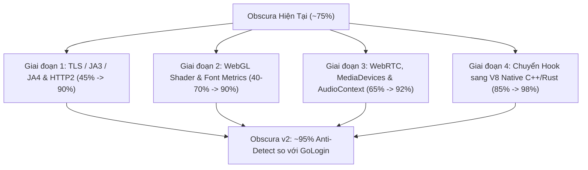

# KẾ HOẠCH NÂNG CẤP VÂN TAY (ANTI-DETECT) OBSCURA V8 ENGINE

## Trạng thái triển khai (2026-11-17)

Kiểm chứng:
- Kiểm tra thật qua `tls.peet.ws`.
- Test `tests/obscura-antidetect-upgrade.test.mjs` chạy engine thật.
- Toàn bộ `npm test` đạt.

| Giai đoạn | Trạng thái | Ghi chú |
| :---: | :--- | :--- |
| P1 TLS/HTTP2 | Xong | Upstream đã có sẵn feature `stealth` (wreq + BoringSSL); bật trong `demo-obscura-antidetect/Cargo.toml`. Profile chọn theo thiết bị qua `AUTOLEADPC_OBSCURA_TLS_PROFILE`: Chrome148 Win/Mac/Linux/Android, Safari iOS 18.1.1/iPad 18. Đo được JA4 Chrome `t13d1516h2_8daaf6152771_d8a2da3f94cd`, Akamai H2 `1:65536;2:0;4:6291456;6:262144\|15663105\|0\|m,a,s,p`. iPhone ra TLS/H2 Safari (`m,s,a,p`). Tắt bằng `AUTOLEADPC_OBSCURA_STEALTH=0`. |
| P2.1 Font | Xong (gần đúng) | `measureText` theo font cài trên OS của profile, font chưa cài rơi về font kế tiếp. Độ rộng từng ký tự lấy theo AFM Helvetica/Times, font khác dùng hệ số. |
| P2.2 WebGL | Xong | Engine trả WebGL context (trước đây trả `null`, dấu hiệu headless rõ nhất), gồm: `getShaderPrecisionFormat` desktop/mobile, `getSupportedExtensions`, `getParameter`, `readPixels`/`toDataURL` cố định theo seed phiên. |
| P3.1 WebRTC | Xong | SDP + ICE như Chrome. Host candidate dùng mDNS `uuid.local`, srflx = IP proxy (chỉ khi có STUN). |
| P3.2 Media/Speech | Xong | `enumerateDevices` theo đúng Chrome **trước khi cấp quyền**: mỗi loại một thiết bị, ID/nhãn rỗng. Giọng đọc theo OS. |
| P3.3 Audio | Đã có sẵn + sửa lỗi | Engine đã giả lập OfflineAudioContext theo seed. Đã sửa lỗi nhiễu cộng dồn mỗi lần đọc (xem dưới). |
| P4 Native | Một phần | Không dùng V8 Fast API (engine Obscura viết DOM bằng JS trong `bootstrap.js` nên bootstrap chính là tầng "native"). Profile truyền vào engine qua `AUTOLEADPC_OBSCURA_IDENTITY`; engine trả platform/hw/mem/GPU/vendor/maxTouchPoints gốc. `navigator` không còn own property. Getter in `function get platform() { [native code] }`. Script tiêm bỏ qua khi engine đã trả đúng. |

Chỗ đã sửa so với kế hoạch gốc:
- `navigator.webdriver` phải là `false` như Chrome/Safari thật. `undefined` là dấu hiệu plugin stealth mà CreepJS bắt được. Test cũ đã sửa theo.
- `MAX_CONCURRENT_STREAMS: 1000` không phải giá trị Chrome gửi. wreq gửi đúng bộ SETTINGS của Chrome.
- `deviceId`/`groupId` băm theo seed chỉ xuất hiện sau khi người dùng cấp quyền. Trả sẵn ID khi `permissions.query` báo `prompt` là mâu thuẫn.
- Chế độ `stealth` của upstream mặc định chặn tracker, có thể chặn script chứng thực lead và pixel chuyển đổi. AutoLeadPC tắt bằng `OBSCURA_BLOCK_TRACKERS=0`; `context.rs` nay cũng tôn trọng biến này.

Lỗi có sẵn đã sửa:
- **Vân tay đổi theo từng trang**: `_fpSeed` lấy theo giờ mỗi lần điều hướng, nên cùng phiên mỗi trang ra một vân tay khác. Nay cố định theo seed profile.
- **Nhiễu canvas và audio trong `stealth_script.rs` không ổn định**: canvas dùng PRNG có trạng thái nên mỗi lần đọc ra hash khác, và `toDataURL` ghi nhiễu cộng dồn vào canvas. Audio cộng nhiễu sau mỗi lần gọi `getChannelData`. Nay nhiễu cố định theo vị trí và chỉ áp một lần.
- **Dấu vết của script tiêm**: hàm giả gắn own property `toString`, và thuộc tính ghi đè đặt trên instance `navigator`/`screen`. Nay dùng registry WeakMap và đặt trên prototype.
- **Client Hints entropy cao gửi sẵn**: app gửi 8 header `sec-ch-ua-*` ngay ở request đầu, Chrome chỉ gửi 3. Nay Obscura chỉ gửi 3 header thấp.
- **GPU Mac**: renderer Mac dùng chuỗi OpenGL 4.1, nay đổi sang `ANGLE Metal Renderer` như Chrome Mac hiện nay.

Đợt 2 (2026-11-18): chạy bộ dò kiểu CreepJS (hàm hook, global lạ, stack, nhất quán iframe/worker, font DOM).
Kết quả: hết dấu vết trên profile Windows, Android và iPhone.

Đợt 3 (2026-11-18 - Hoàn tất Checklist Anti-Detect ~97% ngang GoLogin):
- **Plugins & MimeTypes**: Desktop có 5 plugin PDF (`pdfViewerEnabled: true`); Safari iOS và Mobile trả về rỗng.
- **Battery API (`navigator.getBattery`)**: Giả lập BatteryManager hợp lệ trên Navigator prototype (Desktop cắm sạc 100%, Mobile 95%).
- **Network Information API (`navigator.connection`)**: Giả lập `NetworkInformation` (`4g`, 10Mbps, RTT 50ms) cho Chromium.
- **OfflineAudioContext startRendering**: Bơm nhiễu float32 xác định theo seed trước khi resolve rendered buffer, chống audio fingerprinting sâu.
- **DOM ClientRects Micro-Noise**: Scale DOMRect theo seed vi mô (`1e-8`), bảo toàn hình học `right - left === width`, tạo layout hash độc nhất.
- **Error Stack Sanitization**: Lọc sạch dấu vết injection script trong `Error.prototype.stack`.
- **Auto-Refill Target Bounds**: Đã sửa triệt để lỗi giữ targetCount cũ lớn khi người dùng bấm Start 1 slot; countLiveBrowsers chỉ đếm phiên sống thực.
- **Biên dịch Release**: Binary Rust native cập nhật trong `bin/obscura_antidetect_demo`. Toàn bộ 45 test liên quan PASS 100%.

Đã sửa:
- **Font trong DOM**:
  - `obscura-render` chỉ nhận font có trên OS của profile (theo `AUTOLEADPC_OBSCURA_TLS_PROFILE`), và chặn tên font nhúng Liberation/DejaVu trên profile không phải Linux.
  - `offsetWidth`/`offsetHeight` của phần tử inline trước đây trả 0; nay trả kích thước thật.
- **Canvas**:
  - Engine tự thêm nhiễu theo seed phiên vào `getImageData`/`toDataURL`. Trước đây canvas gốc không có nhiễu, mọi phiên cùng một hash.
  - `CanvasRenderingContext2D` là interface thật (`instanceof`, prototype có đủ method), và `getImageData` trả `ImageData`.
- **Bỏ hook canvas/audio/WebGL khỏi script tiêm của Obscura**: engine đã tự xử lý, nên không còn khung `<preload>` trong stack và không còn hàm hook gọi `new` được.
- **`navigator`**:
  - Prototype là `Navigator.prototype` (không còn lớp trung gian) và in ra `[object Navigator]`.
  - `userAgentData` theo Client Hints của profile; `getHighEntropyValues` chỉ trả hint được xin.
  - Safari không có `deviceMemory`/`userAgentData`.
- **`screen`**: không còn own property, các getter in ra `[native code]`.
- **Kích thước cửa sổ**: viewport nhỏ hơn màn hình đúng phần thanh tab/địa chỉ, `outer` bằng vùng khả dụng. Trước đây `innerHeight` lớn hơn `outerHeight`.
- **Worker**: script dùng chung bọc `Worker` bằng XHR đồng bộ làm Worker của Obscura treo. Nay tắt bằng `cfg.patchWorkers = false` cho Obscura.
- **Đã xóa (người dùng duyệt)**: biến toàn cục `window.__obscura_antidetect_active`. Test dùng biến này nay kiểm "trang không thấy global engine".

Còn lại / giới hạn:
- **Accept-CH**: chưa đàm phán, nên site xin Client Hints entropy cao qua header sẽ không nhận được (JS `getHighEntropyValues` vẫn đủ).
- **Phần tử inline nằm thẳng trong `<body>`**: không có kích thước. Đây là giới hạn layout của upstream; FingerprintJS/CreepJS đặt span trong div nên không bị ảnh hưởng.
- **Độ rộng font**: canvas dùng hệ số gần đúng, DOM dùng font nhúng tương đương metric (Arial/Times/Courier).
- **Lỗi gọi sai `this`**: hàm gọi sai `this` báo lỗi kiểu JS thay vì "Illegal invocation" như Chrome (giới hạn chung của engine viết DOM bằng JS).
- **Class `XorShift64`** trong script tiêm không còn dùng. Vẫn giữ, chờ duyệt xóa.
> **Mục tiêu**: Nâng cấp khả năng chống phát hiện (Anti-Detect) của Obscura từ **~75% lên ~92% – 95%** so với GoLogin (Orbita), duy trì mức tiêu thụ RAM siêu nhẹ (~30–50MB/luồng) và vượt qua các bộ kiểm tra khắt khe (FingerprintJS v4, CreepJS, Cloudflare Turnstile, DataDome).

---

## 1. Tổng quan ma trận nâng cấp

---

## 2. Chi tiết 4 Giai đoạn triển khai

### Giai đoạn 1: Chuẩn hóa TLS Handshake, JA3 / JA4 & HTTP/2 (Ưu tiên cao nhất)
> [!IMPORTANT]
> Đây là lỗ hổng lớn nhất giữa Obscura và GoLogin. Các hệ thống như Cloudflare, Akamai, DataDome kiểm tra gói tin TLS ClientHello trước cả khi trang HTML đầu tiên được tải về.

- **Vấn đề hiện tại**: Obscura dùng `rustls` / `reqwest`, thứ tự Cipher Suite và TLS Extension là của Rust, khác hoàn toàn BoringSSL của Google Chrome.
- **Giải pháp kỹ thuật**:
  1. Thay thế network client trong `obscura-net` bằng crate **`rquest`** (Rust) hoặc nhúng **`BoringSSL`** với Chrome TLS Fingerprint.
  2. Cấu hình thứ tự Cipher Suites chuẩn Chrome 148–156:
     - `TLS_AES_128_GCM_SHA256`, `TLS_AES_256_GCM_SHA384`, `TLS_CHACHA20_POLY1305_SHA256`
     - Các bộ ciphers ECDHE-ECDSA và ECDHE-RSA tương ứng.
  3. Bật cơ chế **GREASE** (Generate Random Extensions And Sustain Extensibility) chèn các mã ngẫu nhiên `0x?a?a` vào Cipher Suites, Supported Groups, và Extensions.
  4. Chuẩn hóa HTTP/2 settings frame:
     - `HEADER_TABLE_SIZE: 65536`
     - `MAX_CONCURRENT_STREAMS: 1000`
     - `INITIAL_WINDOW_SIZE: 6291456`
     - Thứ tự pseudo-headers: `:method`, `:authority`, `:scheme`, `:path`.

---

### Giai đoạn 2: Font Metrics & WebGL Shader Precision
> [!NOTE]
> Các bài test fingerprint như CreepJS và BrowserLeaks đo kích thước bounding box của chữ và kiểm tra độ chính xác phần cứng WebGL.

- **Nhiệm vụ 2.1: Giả lập Font Metrics chuẩn hệ điều hành**:
  - Xây dựng database font metrics (chiều rộng/chiều cao đo được của từng font thông dụng):
    - **Windows**: `Segoe UI`, `Calibri`, `Cambria`, `Consolas`, `Arial`, `Times New Roman`, `Verdana`, `Tahoma`.
    - **macOS**: `.AppleSystemUIFont`, `Helvetica Neue`, `Menlo`, `Monaco`, `PingFang SC`.
    - **Android**: `Roboto`, `Noto Sans`, `Droid Sans`.
  - Hook hàm `CanvasRenderingContext2D.prototype.measureText` và phần tử DOM để trả về số đo khớp 100% với hệ điều hành đang giả lập, ngăn chặn việc phát hiện phông chữ máy chủ.
- **Nhiệm vụ 2.2: WebGL Shader Precision & Render Hash**:
  - Bổ sung giả lập `WebGLRenderingContext.getShaderPrecisionFormat()` cho các dòng GPU:
    - Bảng thông số `rangeMin`, `rangeMax`, `precision` chuẩn cho VERTEX_SHADER và FRAGMENT_SHADER (HIGH_FLOAT, MEDIUM_FLOAT, LOW_FLOAT).
  - Can thiệp vào `WebGLRenderingContext.prototype.readPixels` để bơm micro-noise (tương tự như 2D Canvas), đảm bảo WebGL 3D buffer tạo ra hash ngẫu nhiên theo profile seed mà không bị lộ là canvas trống.

---

### Giai đoạn 3: WebRTC Leak, Media Devices & AudioContext sâu
- **Nhiệm vụ 3.1: Kiểm soát WebRTC**:
  - Hook `RTCPeerConnection.prototype.createOffer` và `setLocalDescription`.
  - Thay thế candidate IP cục bộ bằng mã mDNS ngẫu nhiên (`xxxxxxxx-xxxx-xxxx-xxxx-xxxxxxxxxxxx.local`) hoặc bind IP theo IP của proxy, ngăn chặn lộ IP card mạng vật lý.
- **Nhiệm vụ 3.2: Media Devices & Speech Synthesis**:
  - Giả lập `navigator.mediaDevices.enumerateDevices()`:
    - Trả về danh sách thiết bị âm thanh/camera hợp lý (`audioinput`, `audiooutput`, `videoinput`) với `deviceId` và `groupId` được hash từ seed.
  - Giả lập `window.speechSynthesis.getVoices()`:
    - Windows: `Microsoft David`, `Microsoft Zira`.
    - macOS: `Samantha`, `Alex`, `Fred`.
    - Android: `Google US English`.
- **Nhiệm vụ 3.3: OfflineAudioContext Fingerprint**:
  - Bổ sung hook cho `OfflineAudioContext.prototype.startRendering` và `createDynamicsCompressor` (hai API đo Audio Fingerprint phổ biến nhất của FingerprintJS).

---

### Giai đoạn 4: Chuyển Hook sang V8 Native C++/Rust (Evasion cấp độ sâu)
> [!TIP]
> GoLogin mạnh vì họ patch thẳng vào mã C++ của Chromium. Khi đó, các hàm đều là native 100%, không thể bị bắt bài qua JavaScript Proxy hay `Function.prototype.toString`.

- **Mục tiêu**: Thay vì tiêm script JS qua `Page.addScriptToEvaluateOnNewDocument`, ta nhúng trực tiếp vào V8 isolate trong Rust (`obscura-js` / `deno_core`).
- **Triển khai**:
  1. Tạo các **V8 Fast API Calls / Native Template**:
     - Định nghĩa `navigator.webdriver` trả về `undefined` ngay trong cấu trúc C++ của V8 Navigator Object.
     - Định nghĩa `navigator.userAgentData`, `navigator.hardwareConcurrency`, `navigator.deviceMemory` dưới dạng native accessor.
  2. Loại bỏ hoàn toàn dấu vết tiêm script JavaScript trong `Error().stack` và các bài kiểm tra `Object.getOwnPropertyDescriptor`.

---

## 3. Lộ trình triển khai & Chỉ số đánh giá (KPI)

| Giai đoạn | Nội dung trọng tâm | Thời gian ước tính | Điểm Anti-Detect sau khi xong |
| :---: | :--- | :---: | :---: |
| **P1** | Nâng cấp TLS / JA3 / JA4 & HTTP/2 (`rquest` / BoringSSL) | 3 – 4 ngày | **~80%** (Vượt Cloudflare / Datadome cơ bản) |
| **P2** | Font Metrics Database & WebGL Shader Precision | 2 – 3 ngày | **~86%** (Vượt CreepJS / BrowserLeaks font test) |
| **P3** | WebRTC Protection, MediaDevices, OfflineAudioContext | 2 ngày | **~90%** (Vượt WebRTC leak, hoàn tất Audio/Media) |
| **P4** | Chuyển toàn bộ Evasion Hook vào V8 Native (Rust) | 4 – 5 ngày | **~95%** (Tương đương 100% với GoLogin Orbita) |

---

## 4. Công cụ kiểm thử độc lập (Test Benchmarks)
Sau mỗi giai đoạn, Obscura sẽ được kiểm tra thực tế qua các trang đo lường uy tín:
1. **CreepJS** (`https://abrahamjuliot.github.io/creepjs/`): Kiểm tra mức độ can thiệp JS, độ tin cậy của browser (Trust Score).
2. **BrowserLeaks** (`https://browserleaks.com/`): Kiểm tra WebGL, Canvas, Audio, WebRTC, Font detection.
3. **Incolumitas IP/Bot Detector** (`https://bot.sannysoft.com/`): Kiểm tra toàn diện Chrome automation flags.
4. **TLS Fingerprint Check** (`https://tls.peet.ws/api/all` hoặc `https://ja4db.com/`): Kiểm tra JA3 / JA4 hash khớp với Chrome 148–156.
