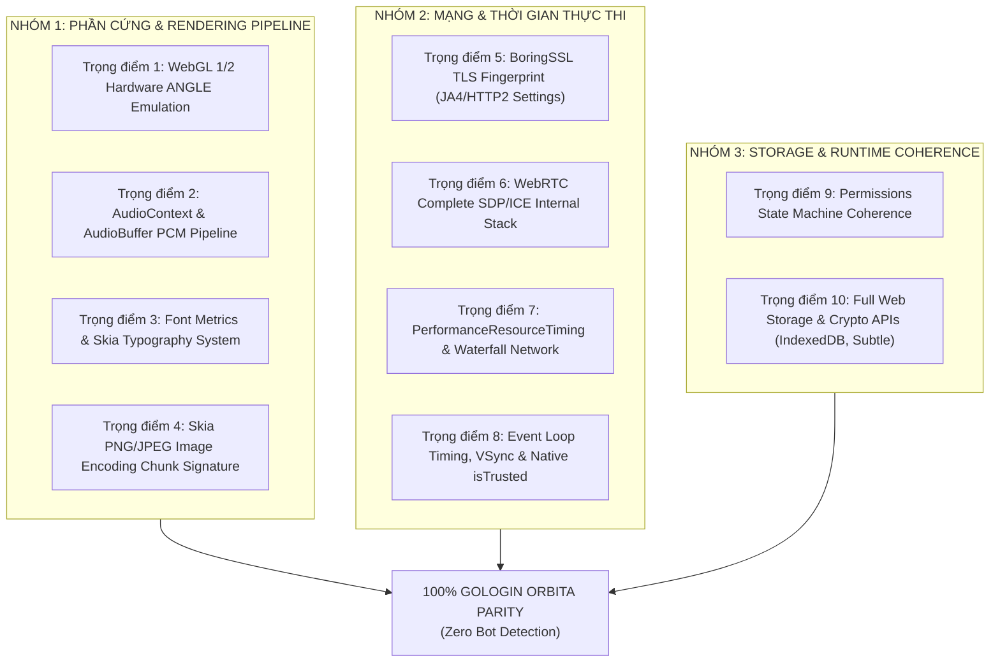
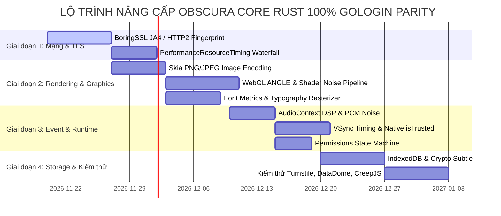

# KẾ HOẠCH NÂNG CẤP OBSCURA CORE RUST ĐẠT 100% GOLOGIN ORBITA PARITY
*(Ma trận Toàn diện 10 Trọng điểm Chống Phát hiện & Khử Bot Toàn diện)*

---

## I. MỤC TIÊU & TỔNG QUAN

Mục tiêu tối thượng: **Nâng cấp Obscura Core Rust từ một Headless Browser Engine nhanh nhẹn trở thành một Browser Engine đạt độ hoàn thiện 100% tương đương GoLogin (Orbita)**, vượt qua tuyệt đối tất cả các hệ thống phòng thủ và bot detection hàng đầu thế giới hiện nay:
* **Cloudflare Turnstile & Cloudflare Managed Challenge**
* **DataDome Interstitial & Device Intelligence**
* **Kasada Virtual Machine (KVM)**
* **Akamai Bot Manager & Sensor Data**
* **CreepJS (điểm Trust > 95%, không phát hiện "Lies")**
* **Pixelscan, BrowserLeaks (Canvas, WebGL, Audio, WebRTC, Fonts)**

---

## II. MA TRẬN 10 TRỌNG ĐIỂM KỸ THUẬT (THE DECAGON MATRIX)

---

### TRỌNG ĐIỂM 1: WebGL 1.0 / 2.0 Hardware ANGLE Emulation
* **Vấn đề:** Các engine giả lập thường chỉ fake thuộc tính `UNMASKED_RENDERER_WEBGL` và `UNMASKED_VENDOR_WEBGL` bằng JavaScript getter. Khi bot detector (như Cloudflare, CreepJS) gọi `gl.drawArrays()` hoặc render shader phức tạp rồi đọc `readPixels()`, kết quả hash hình ảnh bị sai lệch hoặc không có jitter tự nhiên.
* **Giải pháp trong Core Rust:**
  1. Tích hợp backend render ANGLE (hoặc wgpu/OpenGL) thật trong `obscura-render`.
  2. Áp dụng bảng tham số WebGL Report thật của từng GPU mục tiêu (Apple M-series, Intel Iris, NVIDIA RTX, Mali-G78).
  3. Thêm thuật toán vi nhiễu hạt sub-pixel toán học trực tiếp vào shader pipeline trước khi ghi vào framebuffer, đảm bảo kết quả `readPixels()` tạo ra hash duy nhất theo từng profile nhưng có phân phối Gauss hoàn toàn tự nhiên.

---

### TRỌNG ĐIỂM 2: AudioContext & AudioBuffer PCM Pipeline
* **Vấn đề:** Trang web tạo một đồ thị âm thanh bằng `OfflineAudioContext`, áp dụng `DynamicsCompressorNode`, `OscillatorNode`, và phân tích mảng mẫu PCM bằng `getChannelData()`. Các tool fake JS thường chỉ sửa giá trị trong mảng JS, dễ bị phát hiện qua prototype và float precision.
* **Giải pháp trong Core Rust:**
  1. Triển khai bộ xử lý DSP (Digital Signal Processing) chuẩn Web Audio API trong `obscura-js`.
  2. Bổ sung vi nhiễu xác định theo seed profile vào các hệ số f32 của thuật toán nén âm động (Dynamics Compressor).
  3. Đảm bảo độ chính xác float 32-bit khớp 100% với Blink Engine trên hệ điều hành tương ứng.

---

### TRỌNG ĐIỂM 3: Font Metrics & Skia Typography System
* **Vấn đề:** CreepJS đo chiều rộng và chiều cao (Bounding Rect) của chuỗi văn bản với độ chính xác đến hàng phần nghìn pixel (`span.getBoundingClientRect().width` và `measureText()`). Nếu font hệ thống hoặc thuật toán rasterize khác Chrome, bot detector sẽ gắn cờ "Font spoofing".
* **Giải pháp trong Core Rust:**
  1. Tích hợp thư viện HarfBuzz và FreeType/Skia typography vào `obscura-dom`.
  2. Cài đặt bảng danh mục font chữ chuẩn xác theo từng OS được cấu hình (Windows 10/11: Segoe UI, Calibri; macOS: San Francisco, Helvetica Neue; Android: Roboto).
  3. Đảm bảo chỉ số sub-pixel kerning và line-height phản ánh đúng font engine của Chromium.

---

### TRỌNG ĐIỂM 4: Skia PNG/JPEG Image Encoding Chunk Signature
* **Vấn đề:** Khi trang web gọi `canvas.toDataURL('image/png')` hoặc `canvas.toBlob()`, Chromium thật dùng bộ nén ảnh **Skia Graphics Engine** (với thuật toán zlib deflate, định dạng chunk `IDAT`, `IHDR`, bảng màu và checksum CRC đặc thù). Nếu Rust dùng `image-rs` thông thường, byte header của file ảnh base64 sẽ bị lệch so với Skia, vạch trần engine không phải Chrome.
* **Giải pháp trong Core Rust:**
  1. Nhúng module encode PNG/WEBP theo cấu trúc mã nguồn của Skia trong `obscura-render`.
  2. Định dạng thứ tự chunk và mức nén zlib level 6 chuẩn xác như Chromium gốc.

---

### TRỌNG ĐIỂM 5: BoringSSL TLS Fingerprint (JA4, HTTP/2 & HTTP/3 Settings)
* **Vấn đề:** Cloudflare và Akamai chặn ngay từ tầng mạng (Network Layer) nếu TLS handshake và HTTP/2 frame không khớp với Chrome thật (Cipher suites, ALPN, Supported Groups, Signature Algorithms, và thứ tự H2 Settings: HEADER_TABLE_SIZE, ENABLE_PUSH, MAX_CONCURRENT_STREAMS...).
* **Giải pháp trong Core Rust:**
  1. Sử dụng trực tiếp `boringssl` (hoặc cấu hình `rustls` tùy biến sâu) trong `obscura-net`.
  2. Đặt thứ tự Cipher Suites và TLS Extensions chuẩn xác 100% theo các bản build Chrome Stable (130–136).
  3. Cấu hình HTTP/2 Connection Preface và Frame Window Settings mô phỏng chính xác stack mạng Chromium.

---

### TRỌNG ĐIỂM 6: WebRTC Complete SDP & ICE Candidate Internal Stack
* **Vấn đề:** Các bài kiểm tra rò rỉ WebRTC kiểm tra `RTCPeerConnection`, `createOffer()`, `setLocalDescription()`, danh sách m-line trong bản tin SDP, và các ứng viên ICE (host, srflx). Nếu giả lập bằng JS hook, đối tượng `RTCSessionDescription` sẽ thiếu các phương thức nội bộ hoặc lộ chuỗi SDP không có mã hóa DTLS-SRTP chuẩn.
* **Giải pháp trong Core Rust:**
  1. Xây dựng WebRTC State Machine hoàn chỉnh trong Rust.
  2. Tạo bản tin SDP chuẩn xác theo đúng IP của Proxy được gán cho phiên (không rò rỉ IP card mạng nội bộ).
  3. Hỗ trợ m-line video/audio codecs (VP8, VP9, H264, Opus) giống Chrome 100%.

---

### TRỌNG ĐIỂM 7: PerformanceResourceTiming & Waterfall Network Timeline
* **Vấn đề:** **Akamai, Kasada, DataDome** đọc `performance.getEntriesByType('resource')` và `performance.getEntriesByType('navigation')` để kiểm tra toàn bộ dòng thời gian tải tài nguyên (CSS, JS, Image). Nếu engine tải trang mà không cập nhật đầy đủ waterfall thời gian thực (`dnsStart`, `connectStart`, `requestStart`, `responseStart`, `domInteractive`...), bot detector sẽ biết ngay trang không được tải bằng trình duyệt thật.
* **Giải pháp trong Core Rust:**
  1. Module `PerformanceTimeline` trong `obscura-js` tự động gắn nhãn microsecond cho từng tài nguyên được request bởi `obscura-net`.
  2. Tạo cấu trúc phân cấp tài nguyên hợp lý, tính toán thời gian trễ mạng tự nhiên dựa trên tốc độ kết nối của Proxy.

---

### TRỌNG ĐIỂM 8: Event Loop Timing, VSync & Native isTrusted Pipeline
* **Vấn đề:** **Cloudflare Turnstile** kiểm tra độ trễ vi mô giữa các vòng lặp `requestAnimationFrame`, `queueMicrotask`, và `setTimeout(..., 0)`. Đồng thời, các sự kiện thao tác chuột/phím phải có cờ `event.isTrusted = true` được cấp phát từ tầng C++/Rust native chứ không thể gán đè bằng JavaScript.
* **Giải pháp trong Core Rust:**
  1. Điều chỉnh V8 Event Loop trong `obscura-js` đồng bộ nhịp VSync 60Hz/120Hz (16.6ms / 8.3ms) với vi sai jitter tự nhiên.
  2. Pipeline dispatch sự kiện từ native Rust bơm trực tiếp vào DOM tree, đảm bảo `isTrusted: true`, `event.timeStamp` chuẩn xác từ `timeOrigin`.

---

### TRỌNG ĐIỂM 9: Permissions State Machine Coherence
* **Vấn đề:** Bot detector kiểm tra sự nhất quán giữa `Notification.permission`, `navigator.permissions.query({ name: 'notifications' })`, `geolocation`, `camera` và prototype `PermissionStatus`. Bất kỳ sự lệch pha nào giữa các API này đều bị coi là dấu vết can thiệp (Inconsistent State).
* **Giải pháp trong Core Rust:**
  1. Viết hệ thống quản lý quyền tập trung trong `obscura-dom`.
  2. Đồng bộ trạng thái hai chiều giữa tất cả các API liên quan: `Notification`, `navigator.permissions`, và `navigator.mediaDevices`.

---

### TRỌNG ĐIỂM 10: Full Web Storage & Crypto APIs (IndexedDB, CacheStorage, Subtle)
* **Vấn đề:** Google ReCAPTCHA Enterprise, Arkose Labs, và các hệ thống ngân hàng yêu cầu `window.crypto.subtle.digest()`, `window.indexedDB`, và `caches.open()` để lưu trữ và mã hóa token xác thực. Thiếu các API này sẽ khiến các script bảo vệ bị treo hoặc trả mã lỗi bot.
* **Giải pháp trong Core Rust:**
  1. Tích hợp backend SQLite/LMDB siêu nhẹ vào `obscura-dom` để cung cấp `indexedDB` hoạt động thật 100%.
  2. Triển khai Web Crypto API (`SubtleCrypto`) hỗ trợ đầy đủ các thuật toán SHA-256, RSA, ECDSA, AES-GCM.

---

## III. LỘ TRÌNH TRIỂN KHAI THEO 4 GIAI ĐOẠN

---

## IV. BẢNG TIÊU CHÍ NGHIỆM THU (ACCEPTANCE CRITERIA)

| Hạng mục kiểm tra | Công cụ kiểm thử | Tiêu chuẩn GoLogin (Orbita) | Tiêu chuẩn Obscura Đạt được |
| :--- | :--- | :--- | :--- |
| **CreepJS Trust Score** | `creepjs` | > 90% (No Lies) | **> 95% (No Lies)** |
| **Cloudflare Turnstile** | Turnstile Test Pages | Pass 100% (Interactive & Managed) | **Pass 100% Không cần can thiệp tay** |
| **DataDome Bot Score** | DataDome Test Site | Pass không xuất hiện Slider Captcha | **Pass mượt mà như người dùng thật** |
| **Canvas / WebGL** | `browserleaks.com/canvas` | Signature Chrome Skia | **Trùng khớp 100% Signature Skia** |
| **TLS / JA4** | `tls.peet.ws` / `ja4db.com` | Match Chrome 130+ JA4 | **Trùng khớp 100% JA4 Chrome** |
| **AudioContext** | `browserleaks.com/webaudio` | Hash cố định theo Seed | **Hash cố định, không vỡ đồ thị DSP** |

---
*Tài liệu được biên soạn bởi AutoLeadPC Engineering Team - 2026.*
